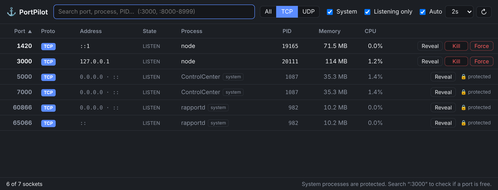

# ⚓ PortPilot

**See which process is using a port, and stop it with one click.**
A small, fast, cross-platform port & process manager built with [Tauri 2](https://tauri.app), Rust and React.

No more `lsof -i :3000 | grep LISTEN` → copy PID → `kill -9`.



## Features

- 📋 Lists every open TCP/UDP port with its owning process, PID, memory and CPU usage
- 🔎 Instant search: process name, PID, address or command line
  - `:3000` matches an exact port, `:8000-8999` matches a range, multiple terms are AND-ed
- ✅ **Is this port free?** Type `:3000` to get an instant answer, and free it with one click
- 🛑 Graceful **Kill** (SIGTERM) or **Force** (SIGKILL) with an inline two-step confirm
- 🔒 System services (e.g. `ControlCenter`, `rapportd`) are marked and protected from being killed
- 🧹 Clean list: IPv4/IPv6 bindings of the same port are merged into one row
- 🔁 Auto refresh (1/2/5/10 s), paused while the window is hidden
- 📂 Reveal a process's executable in Finder / Explorer
- ↕️ Sortable columns, TCP/UDP filter, "listening only" toggle
- 🌗 Light and dark mode follow the system
- 🪶 Native & lightweight: no Electron, no shelling out to `lsof`/`netstat`

### Keyboard shortcuts

| Shortcut       | Action        |
| -------------- | ------------- |
| `⌘/Ctrl + F`   | Focus search  |
| `⌘/Ctrl + R`   | Refresh       |
| `Esc`          | Clear search  |

## Install

Download the latest build for macOS, Windows or Linux from the [Releases](../../releases) page.

> **macOS:** builds are not notarized yet. If macOS refuses to open the app, right-click → **Open**, or run
> `xattr -dr com.apple.quarantine /Applications/PortPilot.app`.

## Development

Prerequisites: [Node.js 20+](https://nodejs.org), [Rust](https://rustup.rs) and the
[Tauri system dependencies](https://tauri.app/start/prerequisites/) for your OS.

```bash
npm install
npm run tauri dev      # run in development mode
npm run tauri build    # produce a release bundle
cd src-tauri && cargo test
```

### Project layout

```
src/                 React + TypeScript UI
  App.tsx            main window
  api.ts             typed wrappers around Tauri commands
  filter.ts          search / sort logic
src-tauri/
  src/ports.rs       socket discovery (netstat2) + process info & kill (sysinfo)
  src/lib.rs         Tauri commands: list_ports, kill_process
```

## Permissions & limitations

- Processes owned by other users, or whose executable lives in an OS directory (`/System`, `/usr/libexec`,
  `C:\Windows`, …), are flagged as **system** and can't be killed from PortPilot.
- PID 0/1 and PortPilot itself are protected from being killed.
- On macOS, ports 5000 and 7000 are used by the AirPlay Receiver. PortPilot shows how to turn it off.
- On Windows there is no SIGTERM; both Kill and Force terminate the process immediately.

## Roadmap

- [ ] Menu bar / system tray mode with a global shortcut
- [x] "Free port N" quick action
- [ ] Favourite / pinned ports (e.g. 3000, 5173, 8080)
- [ ] Notifications when a watched port opens or closes
- [ ] Show established connections per process
- [ ] Docker container names for published ports

Contributions are welcome! Check the issues labelled `good first issue`.

## License

[MIT](LICENSE)
