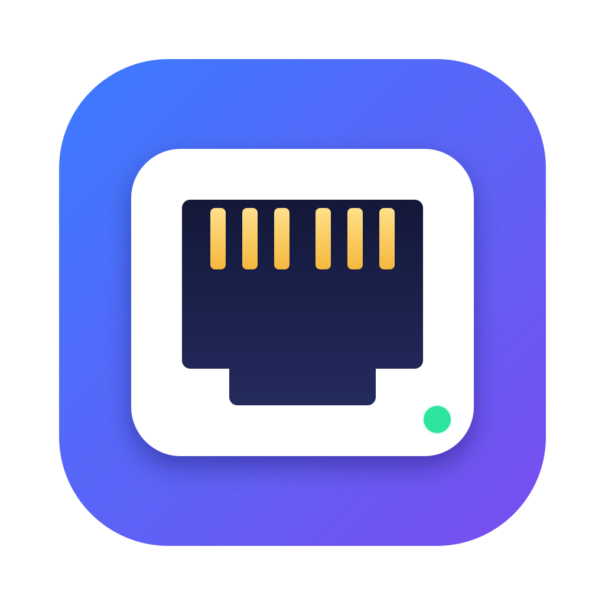
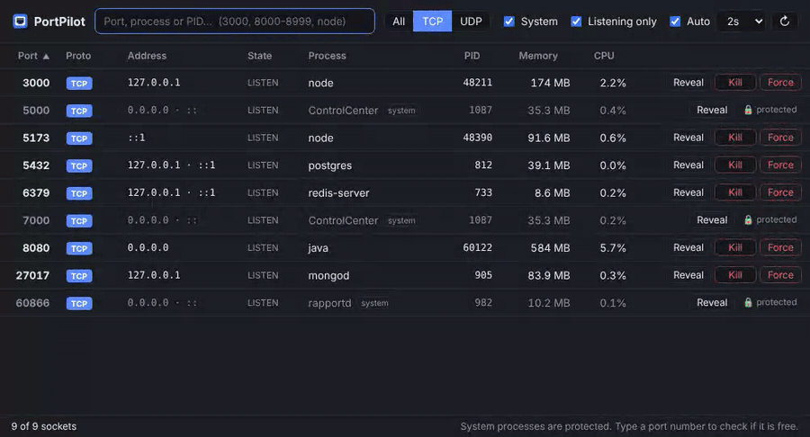
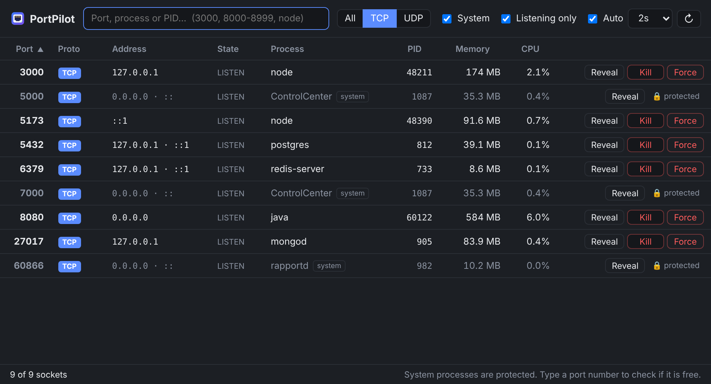
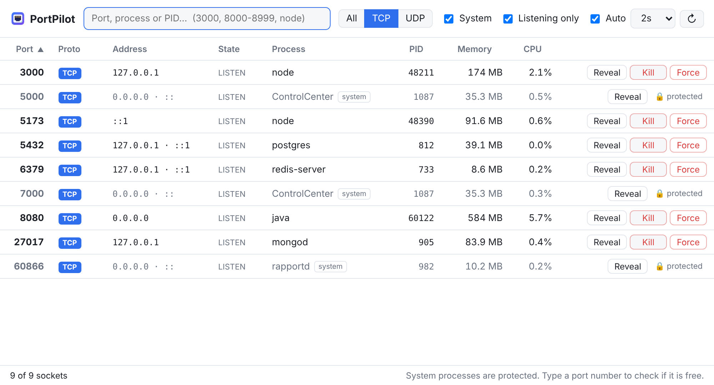
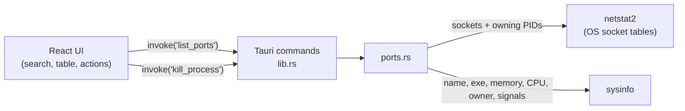

<div align="center">



# PortPilot

**See which process is using a port, and free it with one click.**

A tiny, fast, cross-platform port & process manager for developers.
Built with [Tauri 2](https://tauri.app), Rust and React.

[](LICENSE)


[Download](../../releases) · [Features](#-features) · [Usage](#-usage) · [Build from source](#-build-from-source) · [Contributing](#-contributing)



</div>

---

## Why?

Every developer has seen this:

```text
Error: listen EADDRINUSE: address already in use :::3000
```

The usual fix is a ritual of terminal commands:

```bash
lsof -i :3000 | grep LISTEN   # find the PID
kill -9 48211                 # hope it's the right one
```

PortPilot replaces that with a window: type `3000`, see what is holding it, and click **Free port 3000**.
It also tells you when a port is taken by an operating system service you should *not* kill, and why
(for example, macOS's AirPlay Receiver sitting on port 5000).

## ✨ Features

| | |
|---|---|
| 🔎 **Port check** | Type a port number and instantly see whether it is free or who is using it. |
| 🧹 **Free port** | Terminate everything holding a port with one click (with a confirmation step). |
| 📋 **Live list** | Every open TCP/UDP port with process name, PID, memory and CPU usage, refreshed automatically. |
| 🔒 **System protection** | OS services and other users' processes are labelled `system` and can't be killed by accident. |
| 💡 **Helpful hints** | Explains well-known conflicts, e.g. AirPlay Receiver on ports 5000/7000 on macOS. |
| 🛑 **Kill or Force** | Graceful `SIGTERM` first, `SIGKILL` when a process refuses to exit. |
| 🧭 **Clean view** | IPv4 and IPv6 bindings of the same port are merged into one row. Unbound sockets are hidden. |
| 📂 **Reveal** | Open a process's executable in Finder / Explorer / your file manager. |
| 🌗 **Light & dark** | Follows your system theme. |
| 🪶 **Lightweight** | Native Rust backend, no Electron and no shelling out to `lsof` or `netstat`. The release binary is about 6 MB. |

<table>
  <tr>
    <td></td>
    <td></td>
  </tr>
</table>

## 📦 Installation

Download the installer for your platform from the [**Releases**](../../releases) page:

| Platform | File |
|---|---|
| macOS (Apple Silicon) | `PortPilot_x.y.z_aarch64.dmg` |
| macOS (Intel) | `PortPilot_x.y.z_x64.dmg` |
| Windows | `PortPilot_x.y.z_x64-setup.exe` or `.msi` |
| Linux | `.AppImage`, `.deb` or `.rpm` |

> **macOS note:** builds are not notarized yet. If macOS says the app "can't be opened",
> right-click the app and choose **Open**, or run:
>
> ```bash
> xattr -dr com.apple.quarantine /Applications/PortPilot.app
> ```

## 🚀 Usage

### Search

The search box understands a few shortcuts:

| You type | What it does |
|---|---|
| `3000` | Shows port **3000** and whether it is free. Also matches a process with PID 3000. |
| `:3000` | Port 3000 only (never matches a PID). |
| `8000-8999` | All ports in a range. |
| `node` | Matches process name, address or full command line. |
| `node 5173` | Multiple terms are combined (AND). |

When the search is a single port, a status bar appears above the table:

- **✓ Port 3000 is free:** nothing is listening on it, you can start your server.
- **✗ Port 3000 is in use by node (PID 48211):** click **Free port 3000** to terminate it.
- **✗ Port 5000 is in use by ControlCenter:** a system service, with a hint on how to turn it off.

### Toolbar

| Control | Meaning |
|---|---|
| **All / TCP / UDP** | Protocol filter. TCP is the default because that is where servers listen. |
| **System** | Show or hide OS services and processes owned by other users. |
| **Listening only** | When on, only sockets **waiting for connections** are shown (servers). Turn it off to also see **active connections** (e.g. your browser talking to a website), shown as `local → remote`. |
| **Auto + interval** | Refresh every 1, 2, 5 or 10 seconds. Refreshing pauses while the window is hidden. |
| **↻** | Refresh now. |

### Actions

| Button | Effect |
|---|---|
| **Kill** | Sends `SIGTERM`, asking the process to shut down cleanly. Click twice to confirm. |
| **Force** | Sends `SIGKILL`, ending the process immediately. Use it when Kill doesn't work. |
| **Reveal** | Shows the executable in your file manager. |
| 🔒 **protected** | System process, so PortPilot will not kill it. |

On Windows there is no `SIGTERM`; both Kill and Force terminate the process.

### Keyboard shortcuts

| Shortcut | Action |
|---|---|
| <kbd>⌘</kbd>/<kbd>Ctrl</kbd> + <kbd>F</kbd> | Focus search |
| <kbd>⌘</kbd>/<kbd>Ctrl</kbd> + <kbd>R</kbd> | Refresh |
| <kbd>Esc</kbd> | Clear search |

## 🧠 How it works



1. **Socket discovery:** [`netstat2`](https://crates.io/crates/netstat2) reads the OS socket tables directly
   (`libproc` on macOS, `/proc` on Linux, IP Helper API on Windows) and returns every TCP/UDP socket with its owning PIDs.
2. **Process details:** [`sysinfo`](https://crates.io/crates/sysinfo) refreshes *only* the PIDs that own sockets,
   adding name, executable path, command line, memory, CPU and owner.
3. **Merging:** sockets with the same protocol, port, state and PID are merged into a single row
   (e.g. `0.0.0.0 · ::`), and port `0` is skipped.
4. **System detection:** a process counts as *system* if it runs as a different user than PortPilot, or if its
   executable lives in an OS directory (`/System`, `/usr/libexec`, `/usr/sbin`, `C:\Windows`, …).
   The backend refuses to kill these, as well as PID 0/1 and PortPilot itself.

## 🛠 Build from source

### Prerequisites

- [Node.js](https://nodejs.org) 20+
- [Rust](https://rustup.rs) (stable)
- Tauri's [system dependencies](https://tauri.app/start/prerequisites/) for your OS
  (Xcode Command Line Tools on macOS, WebView2 on Windows, `webkit2gtk` on Linux)

### Commands

```bash
git clone https://github.com/<your-username>/portpilot.git
cd portpilot
npm install

npm run tauri dev       # run with hot reload
npm run tauri build     # build installers into src-tauri/target/release/bundle
```

### Tests

```bash
cd src-tauri
cargo test
```

The tests open real sockets and spawn a child process to check discovery, IPv4/IPv6 merging,
system-path detection and the kill safeguards.

### Project structure

```
portpilot/
├── src/                     # React + TypeScript frontend
│   ├── App.tsx              # main window, table, port-status banner
│   ├── api.ts               # typed wrappers around Tauri commands
│   ├── filter.ts            # search syntax, sorting, formatting
│   └── App.css              # styles (light/dark)
├── src-tauri/               # Rust backend
│   ├── src/ports.rs         # socket discovery, merging, system detection, kill
│   ├── src/lib.rs           # Tauri commands: list_ports, kill_process
│   ├── capabilities/        # Tauri permission configuration
│   └── tauri.conf.json      # window, bundle and security (CSP) settings
├── docs/                    # logo, screenshots, demo GIF
└── .github/workflows/       # CI (build + test) and Release (installers)
```

### Releasing

Pushing a version tag builds installers for macOS (Apple Silicon and Intel), Windows and Linux and attaches
them to a **draft** GitHub release:

```bash
git tag v0.1.0
git push origin v0.1.0
```

Review the draft on the Releases page and publish it.

## ❓ FAQ

<details>
<summary><b>Why can't I kill a process marked <code>system</code>?</b></summary>

Those are OS services (AirDrop, AirPlay, Bonjour, …) or processes owned by another user.
Killing them can break your system or simply fail due to permissions, so PortPilot blocks it.
If you really need to, use the terminal with `sudo`.
</details>

<details>
<summary><b>Port 5000 or 7000 is taken on my Mac. What is it?</b></summary>

It's the macOS **AirPlay Receiver** (`ControlCenter`). Turn it off in
**System Settings → General → AirDrop & Handoff → AirPlay Receiver**, or run your app on another port.
</details>

<details>
<summary><b>Some rows show "unknown" as the process.</b></summary>

The OS did not expose the owning process, usually because it belongs to another user or to the kernel.
These rows are treated as system rows.
</details>

<details>
<summary><b>Why is UDP shown even with "Listening only" on?</b></summary>

UDP has no connections and no "listening" state. A bound UDP socket is the equivalent of a listening one,
so it is always shown when the UDP filter is active.
</details>

<details>
<summary><b>Does PortPilot send any data anywhere?</b></summary>

No. It makes no network requests. Everything is read locally from your operating system.
</details>

## 🗺 Roadmap

- [x] Port check and one-click "Free port"
- [x] System process protection
- [ ] Menu bar / system tray mode with a global shortcut
- [ ] Pinned ports (e.g. 3000, 5173, 8080) with status at a glance
- [ ] Notifications when a watched port opens or closes
- [ ] Docker container names for published ports
- [ ] Group rows by process
- [ ] Code signing and notarization for macOS

Ideas and feedback are welcome in [Issues](../../issues).

## 🤝 Contributing

Contributions are very welcome! Please read [CONTRIBUTING.md](CONTRIBUTING.md) to get started.
Look for issues labelled `good first issue` if this is your first contribution.

## 📄 License

[MIT](LICENSE) © 2026 Muhammet Yusuf Piroglu
